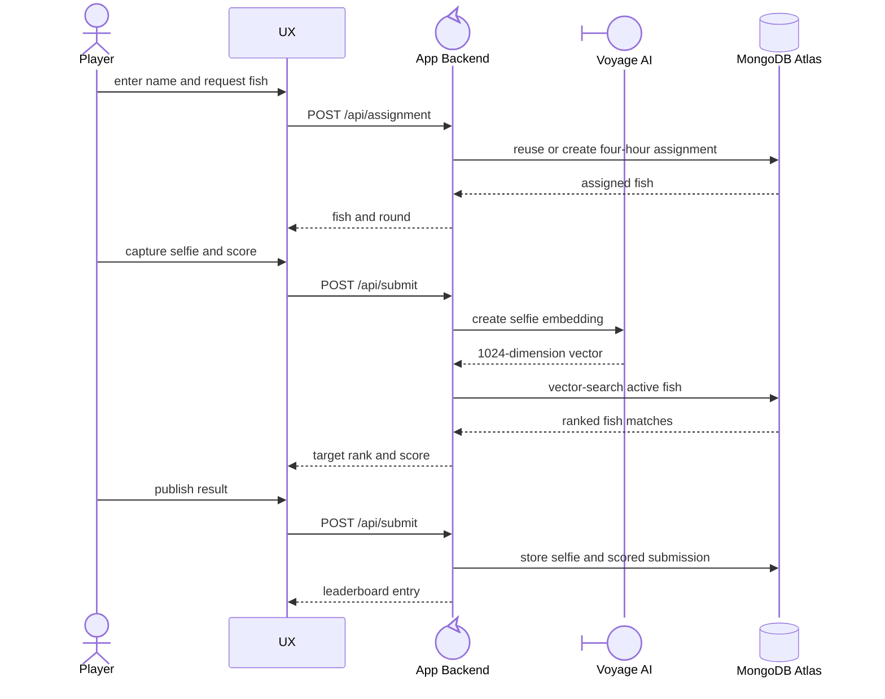

# FishFace

The most exciting fish-impersonation game built with MongoDB Atlas, Atlas multimodal embeddings, Atlas Vector Search, and the MongoDB driver.

## Gameplay



Rounds last four hours. A player keeps one assigned fish per round unless they choose a reroll. A score wins when the assigned fish is the highest-ranked catalog match for the selfie; the leaderboard orders scored submissions by win, target rank, target margin, and time.

## Photo Booth

Open `/booth` directly for a separate flow. Enter a name, start a turn, switch fish if desired, and take a selfie. The booth scores and saves the result immediately, then shows a named photostrip with the target fish, selfie, best match, QR permalink, and print action. End Turn adds the result to the shared leaderboard and returns to the booth start screen. The booth does not display a leaderboard. Saved results remain public at `/booth/result?id=<id>` (with an optional trailing slash). `/booth/result/<id>` redirects to the query URL, including on GitHub Pages.

## Local development

Prerequisites: Bun, Python (only for `prep:images`), and a MongoDB Atlas deployment with Atlas Vector Search and Atlas AI access.

```powershell
Copy-Item .env.example .env.local
bun install
bun run dev
```

Set these server-side values in `.env.local`:

```dotenv
MONGO_URL=mongodb+srv://...
MONGODB_DB=fishface
MONGODB_ATLAS_AI_API_KEY=...
```

`MONGODB_ATLAS_AI_API_KEY` is a MongoDB Atlas model API key used only by the server-side embedding request. Do not expose it to the browser.

After adding catalog images, run `bun run sync:fish-assets` to copy them into `public/fish` for the web app.

Run the test suite and production build with:

```powershell
bun test
bun run build
```

To build the GitHub Pages site into `out/`, set `FISHFACE_API_ORIGIN` to the Azure Function App origin and run `bun run build-gh-static`. The build uses `/FishFace` as the site path by default. Set `FISHFACE_BASE_PATH` to another path, or to an empty string for a root domain. The Pages workflow reads the repository variable `FISHFACE_API_ORIGIN` and uses the Pages base path. Local development still uses same-origin API requests.

To run the built app locally:

```powershell
bun run start
```

## Deploy to a Node.js host

### Azure Functions API and GitHub Pages UX

`.github/workflows/main_fishface.yml` builds the Next.js server and deploys it to the Linux Function App `fishface`. It includes Node.js 22, dependencies, and `.next` in the ZIP. `host.json` runs `next start` directly with the bundled Node.js runtime. The HTTP trigger forwards `/api/*` requests to Next.js on `FUNCTIONS_CUSTOMHANDLER_PORT`; the public UX stays on GitHub Pages.

The deploy job sets `FUNCTIONS_WORKER_RUNTIME=Custom` and adds the GitHub Pages origin to Azure CORS. Its Azure identity needs permission to update Function App settings and CORS. For a custom Pages domain, set repository variable `FISHFACE_SITE_ORIGIN` to its origin (for example, `https://fish.example.com`, with no path or trailing slash). The default is `https://<repository-owner>.github.io`.

Set `MONGO_URL`, `MONGODB_DB`, and `MONGODB_ATLAS_AI_API_KEY` in the Function App environment settings. Set repository variable `FISHFACE_API_ORIGIN` to the Function App HTTPS origin, with no `/api` suffix. The Pages workflow embeds that origin in the static UX. Keep `GH_STATIC_EXPORT` unset in the Function App.

### Other Node.js hosts

Deploy to a host that supports a Node.js Next.js server. Configure the same three environment variables as production secrets; `MONGO_URL` must be able to reach the Atlas deployment from the host. Use `bun run build` as the build command and `bun run start` as the start command. The app is not a static export: its API routes require a running server.

Before the first deployment, load the catalog and create its indexes from a machine with the production environment variables. This command drops and recreates the collections, so use it only for an empty database:

```powershell
bun run prep:db
```

Run this only after adding catalog images to `data/fish/images`. It creates ordinary indexes and the `fish_embedding` Atlas Vector Search index, then inserts embeddings for previously unseeded `fish-*` images. Ensure the Atlas Search index is ready before accepting submissions.

## MongoDB and embeddings

The app uses the `MONGODB_DB` database (default `fishface`) and these collections:

- `fish`: active catalog fish, source metadata, and a 1024-dimension image embedding.
- `assignments`: one fish per player per four-hour round, enforced by a unique index.
- `submissions`: scored attempts, their embeddings, and leaderboard fields.
- `selfies.files` / `selfies.chunks`: GridFS storage for published selfies.
- `fish.files` / `fish.chunks`: optional GridFS storage for catalog images.

The seed script sends every catalog image to Atlas AI's `voyage-multimodal-3.5` model with `input_type: null` and stores its 1024-dimension embedding in `fish.embedding`. At score time, the server sends the selfie to the same model. It then runs an exact cosine-similarity `$vectorSearch` across active fish using `fish_embedding`, which ranks the full catalog and yields the assigned fish's rank and similarity margin.

The stored similarity is a multimodal vector-search score, not a calibrated percentage of human likeness. Treat it as a ranking signal.

## Fish catalog

Collect candidate images with:

```powershell
bun run collect:fish
```

This downloads the curated URLs in `scripts/getFish.py` to `.tmp/fish-images`. Review image source licenses before selecting files for `data/fish/images`, preprocessing them, or publishing them. Then run `bun run prep:db` to embed and insert the selected `fish-*` images.
